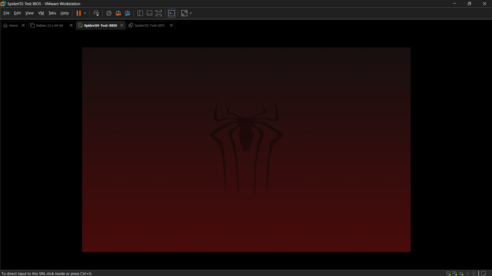
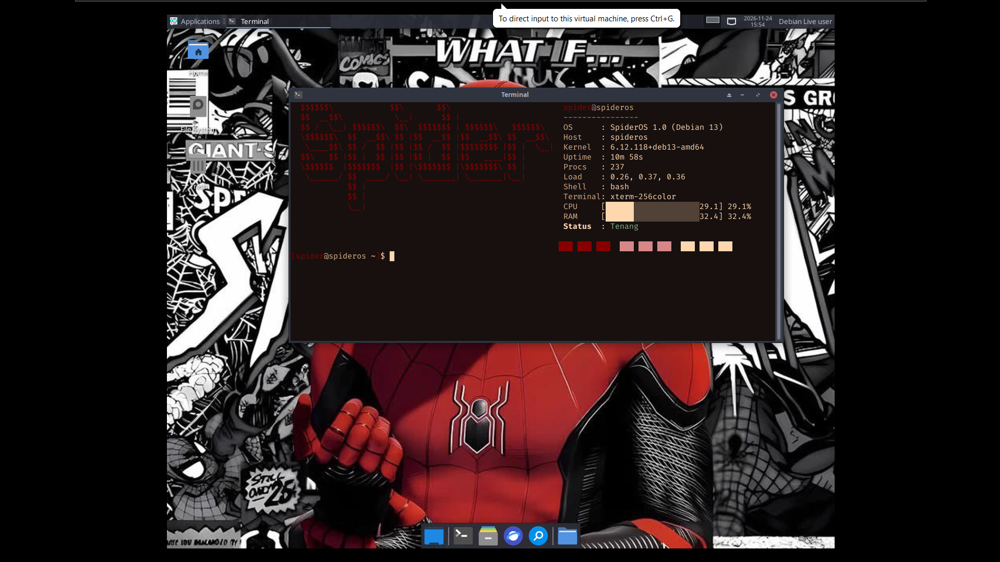

# SpiderOS

Distribusi **live Debian 13 (trixie)** bertema Spider-Man yang dibangun dengan `live-build`, memakai desktop **XFCE 4.20**, dan menyertakan **Spider-Sense** — monitor sistem berbasis Rust yang membaca dan mem-parsing `/proc` secara langsung.

SpiderOS berjalan langsung dari flashdisk tanpa instalasi ke hard disk. ISO bersifat hybrid sehingga dapat boot baik di BIOS maupun UEFI.

**Stack:** Debian 13 · live-build · Rust · XFCE 4.20 · Python (aset visual)

## Tampilan

| Plymouth saat boot                                                | Desktop + Spider-Sense                                                        |
| ----------------------------------------------------------------- | ----------------------------------------------------------------------------- |
|  |  |

## Fitur

- **Langsung dipakai** — ISO hybrid ±1,8 GB, auto-boot ke desktop, tanpa proses instalasi.
- **Satu identitas visual** — wallpaper, greeter, Plymouth, boot loader, terminal, dan prompt memakai palet warna yang sama dengan Spider-Sense.
- **Spider-Sense** — monitor sistem Rust std-only dengan parser `/proc` manual, sampler CPU delta, renderer ANSI, status Tenang/Waspada/BAHAYA, dan 15 unit test.
- **Satu biner, dua mode** — `neofetch` menampilkan satu frame lalu kembali ke prompt; `spider-sense` atau `sense` menampilkan mode live.
- **Siap offline** — browser, pemutar media, pembaca komik CBZ/CBR dengan bookmark, dan empat game tersedia langsung dari menu.
- **Mudah dibangun ulang** — seluruh konfigurasi berupa berkas di Git, dengan cache paket yang tetap dipakai antar build.

## Status rilis

| Item    | Nilai                                                              |
| ------- | ------------------------------------------------------------------ |
| ISO     | `spideros-v1.iso`                                                  |
| Ukuran  | 1.930.952.704 byte (~1,80 GiB)                                     |
| SHA-256 | `8eac0f45a948f01c671dbac81e5654153ed3c4d58c28173cc74df9a4965a74ca` |

## Struktur repositori

| Folder                | Isi                                                                               |
| --------------------- | --------------------------------------------------------------------------------- |
| `auto/`               | Konfigurasi `lb config` (distribusi trixie, arsitektur amd64, ISO hybrid)         |
| `config/`             | Daftar paket, hook template, dan berkas tema untuk chroot                         |
| `scripts/`            | Skrip build, staging Rust, pemasangan hook, boot loader, dan sinkronisasi artefak |
| `tools/spider-sense/` | Sumber Rust Spider-Sense beserta test dan panduan pengembangan                    |
| `docs/`               | Dokumentasi modul, catatan progres, laporan, panduan pengguna, dan catatan rilis  |
| `assets-final/`       | Aset visual final (PNG)                                                           |
| `assets-src/`         | Sumber vektor logo                                                                |
| `dist/`               | Artefak build: ISO, `.sha256`, dan proposal (di-ignore Git)                       |

Semua hook disimpan sebagai template terlacak di `config/hooks-templates/`. Folder `config/hooks/` di-ignore dan dibuat di VM oleh `scripts/install-hooks.sh`.

## Membangun ISO

Build wajib dijalankan di VM Debian 13, pada path native `~/spider-os-build` — bukan di `/mnt/hgfs`.

```bash
git clone https://github.com/SerenaaaaRN/spider-os.git
cd spider-os
./scripts/install-hooks.sh
./scripts/setup-bootloaders.sh
./scripts/build.sh v1
```

`scripts/build.sh` akan menyiapkan sumber Spider-Sense, menjalankan `lb clean` tanpa `--purge` agar cache paket tetap dipakai, membangun ISO, lalu membuat berkas `.sha256` di `dist/`.

Untuk menyalin ISO, log, dan screenshot ke folder Windows:

```bash
./scripts/sync-artifacts.sh
```

Alur source memakai Git: edit di Windows → commit → push → `git pull` di VM. Folder bersama `/mnt/hgfs/SpiderOS-Share/spider-os` hanya dipakai untuk artefak.

## Memakai ISO

1. Buat flashdisk dari `spideros-v1.iso` dengan Rufus atau Balena Etcher.
2. Jika diperlukan, matikan Secure Boot di BIOS saat boot pertama.
3. Sistem masuk otomatis sebagai user `spider` dengan kata sandi `live`.
4. Jalankan monitor sistem:

```bash
neofetch                 # satu frame, prompt langsung kembali
spider-sense             # mode live, hentikan dengan Ctrl+C
spider-sense --once      # satu frame lalu keluar
spider-sense --no-color  # tanpa warna ANSI
spider-sense --version   # spider-sense 1.0.0 (Rust, std-only)
```

Komik ditempatkan sendiri oleh pengguna di `/usr/share/spideros/comics/`, lalu dibuka lewat aplikasi "SpiderOS Comics".

## Dokumentasi

- [`docs/index.md`](docs/index.md) — peta seluruh dokumentasi
- [`docs/laporan.md`](docs/laporan.md) — laporan tugas besar lengkap
- [`docs/panduan_pengguna.md`](docs/panduan_pengguna.md) — panduan penggunaan ISO
- [`docs/release_notes.md`](docs/release_notes.md) — catatan rilis
- [`docs/catatan.md`](docs/catatan.md) — log pengerjaan dan hasil uji
- [`docs/desain.md`](docs/desain.md) — palet dan spesifikasi aset visual
- [`docs/modules/`](docs/modules/) — modul phase, `modul_guide.md` dihasilkan oleh `python scripts/generate-modul.py`
